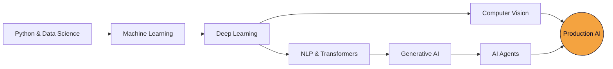

<div align="center">


<a href="https://git.io/typing-svg">

</a>

<br/>


<br/><br/>


</div>

<br/>


## ⚡ About Me

```python
class SantanuSahoo:
    role       = "Machine Learning Engineer (in the making)"
    education  = "B.Tech, Computer Science & Engineering"
    stack      = ["Python", "PyTorch", "TensorFlow", "OpenCV", "FastAPI"]
    exploring  = ["NLP", "Transformers", "Generative AI", "AI Agents"]
    philosophy = "Ship models that work in the real world, not just in notebooks."

    def current_goal(self):
        return "Build real-world, production-grade AI applications."
```

<br/>

## 🧰 Tech Arsenal

<div align="center">

<table>
<tr>
<td align="center" width="200"><b>🗣️ Languages</b></td>
<td>

</td>
</tr>
<tr>
<td align="center"><b>📊 ML & Data</b></td>
<td>


</td>
</tr>
<tr>
<td align="center"><b>🧠 Deep Learning & Vision</b></td>
<td>


</td>
</tr>
<tr>
<td align="center"><b>🛠️ Backend</b></td>
<td>


</td>
</tr>
<tr>
<td align="center"><b>🔧 Tools</b></td>
<td>

</td>
</tr>
</table>

</div>

<br/>

## 📈 Proficiency

<div align="center">

| Skill | Level |
|:--|:--|
| **Python** |  |
| **Machine Learning** |  |
| **Deep Learning** |  |
| **Computer Vision** |  |
| **Backend Development** |  |

</div>

<br/>


## 🚀 Featured Projects

<table width="100%">
<tr>
<td width="50%" valign="top">

### 🎯 AI Attendance System
Real-time face detection and recognition that marks attendance automatically — no cards, no queues.


`MTCNN` · `FaceNet` · `Real-Time Inference`

<a href="#"></a>

</td>
<td width="50%" valign="top">

### 📉 Customer Churn Prediction
End-to-end ML pipeline that predicts which customers are likely to leave, from behavioral data.


`EDA` · `Feature Engineering` · `Model Tuning`

<a href="#"></a>

</td>
</tr>
</table>

<!-- Add more project cards by copying a <td> block. Replace "#" with your repo URL. -->

<br/>

## 🗺️ Learning Roadmap



<div align="center">


</div>

<br/>


## 📊 GitHub Stats

<div align="center">


</div>

<br/>

## 🎯 Goal

<div align="center">

> *"Become a strong Machine Learning Engineer and build real-world, production-grade AI applications."*

<br/>


</div>
